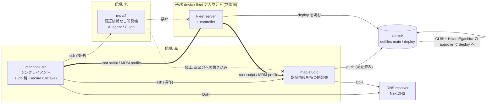

# 脅威モデル: 端末と管理基盤

## 1. 信頼区分

| 端末                    | 役割                                                                | 持つ認証情報                                                                                                                                                                                                   | 信頼                                                                                                                                           |
| ----------------------- | ------------------------------------------------------------------- | -------------------------------------------------------------------------------------------------------------------------------------------------------------------------------------------------------------- | ---------------------------------------------------------------------------------------------------------------------------------------------- |
| macbook-air             | シンクライアント。手元で操作する入口                                | Secure Enclave の sudo 鍵 (Secretive、署名ごとに Touch ID)。tailnet の利用者 identity。AWS と Cloudflare の資格情報は持たず、mac-studio 経由でだけ届く (telemetry 送信用の Access token は例外)                | 高。ここが落ちると他も落ちる                                                                                                                   |
| mac-studio              | 認証情報を持つ開発機。自律 AI `ledger` が常駐                       | GitHub user token (ghtkn、8h。開発用 `ghtkn-hikae` と host 専用 `ghtkn-hikae-ops`)、AWS SSO、Cloudflare の wrangler OAuth と Access session、`~/.config/secrets/env.age` の secret、Claude / OpenAI の資格情報 | 高                                                                                                                                             |
| ms-a2                   | 認証情報を持たない開発機。自律 AI `hikaevi`・CI job・実験を走らせる | 原則なし (例外は §3 F3)                                                                                                                                                                                        | 低                                                                                                                                             |
| phone (`poco-f7-ultra`) | 持ち歩く端末。Fleet の管理外                                        | tailnet の利用者 identity                                                                                                                                                                                      | 低。紛失・乗っ取りを前提に、tailnet では exit node と Fleet 登録 (`tag:fleet:443`) にしか届かない (iac-tailscale の posture `posture:desktop`) |
| AWS (Fleet)             | 端末管理と dotfiles 配布の制御面                                    | Fleet admin、enroll secret、MDM の APNs 証明書                                                                                                                                                                 | 高。全 Mac に root で書ける                                                                                                                    |

**不変条件:** 信頼の低い区分から高い区分へは、書き込みもコード実行もさせない。ms-a2 から mac-studio・macbook-air・AWS の制御面へ向かう経路は、読み取りも含めて最小にする。

## 2. 構成と信頼境界

太線は root 権限での書き込み。Fleet は全 Mac の root を握るため、高区分の中でも最も強く守る。

## 3. 経路と対策

番号はコードのコメントから参照されるので振り直さない。

| #   | 経路                                                                                     | 対策                                                                                           | 状態                                                                                                                     |
| --- | ---------------------------------------------------------------------------------------- | ---------------------------------------------------------------------------------------------- | ------------------------------------------------------------------------------------------------------------------------ |
| F1  | ms-a2 に転送した sudo 鍵の agent で、mac-studio の sudo を通せる                         | ms-a2 へ転送せず、ms-a2 の sudo はパスワード                                                   | 対応済み (flake check `ms-a2-no-sudo-agent`)                                                                             |
| F2  | ms-a2 の gypxy hub が高区分の GitHub token を読み、取得コードを改ざんできる              | 各端末が自分の loopback で hub を動かす                                                        | 対応済み                                                                                                                 |
| F3  | ms-a2 の claude self-hosted runner が `/etc/claude-runner/env` に token を持つ           | token を runner 登録だけに絞り、失効手順を持つ                                                 | 未対応                                                                                                                   |
| F4  | ms-a2 が利用者 identity で tailnet に入り、高区分の全 port に届く                        | ms-a2 を `tag:untrusted-dev` にし、ACL を `iac-tailscale` で管理                               | ACL 適用済み。ms-a2 への tag 付与が未了                                                                                  |
| F5  | ghtkn と gypxy hub を通らない GitHub 経路 (gh の API、ms-a2 の runner と CI job)         | gypxy に HTTPS_PROXY 受け口 (gh-intel/gh-intel#1083)、ms-a2 の runner 用 hub (#374)            | 一部対応                                                                                                                 |
| F6  | AI sandbox が AWS broker から特権 profile を受け取れる                                   | broker を read 系と特権に分け、sandbox には read 系の socket だけ許す                          | 対応済み (`tests/aws-cred-broker.sh`, `tests/ai-sandbox-deny-lists.sh`)                                                  |
| F7  | sandbox が ghtkn socket から workflows・管理系を書ける token を得られる                  | App を 4 段に分け、workflows は host 専用の ops App に移す (operations §3.4.1)                 | 対応済み (flake check `ghtkn-app-tiers`)。sandbox は contents / pull_requests write を持ち、main は ruleset と CI で守る |
| F8  | sandbox が hikaevi App の installation token と、SSM の App 秘密鍵を読める               | 発行を host 側に移し、ReadOnlyAccess の SSM 例外を外す                                         | 未対応 (hikaevi#1172、iac-aws#1069)                                                                                      |
| F9  | `dotfiles-sync` と Fleet の apply が sandbox から書ける checkout を sandbox 外で実行する | origin main の SHA を `github:` ref で build し、checkout の git を実行しない                  | 対応済み (`tests/dotfiles-sync.sh`)                                                                                      |
| F10 | sandbox が sandbox 外で無人実行される設定・hook・script を書き換えられる                 | denyWrite に入れ、ledger の agent の実行物を store path にする (#380)                          | 一部対応                                                                                                                 |
| F11 | ms-a2 の home-manager が書き込み可能な認証情報を置く                                     | ms-a2 は `ghtkn.readonly`、`aws.enable = false`、`cloudflare.enable = false`                   | 対応済み (flake check `ms-a2-no-write-credentials`)                                                                      |
| F12 | Tailscale の制御面が node を勝手に追加する                                               | Tailnet Lock。署名鍵は mac-studio と macbook-air (operations §3.9)                             | 対応済み                                                                                                                 |
| F13 | AI agent や侵害された開発機が vault から任意の資格情報を引き出す                         | vault はシンクライアントだけで開き、開発機にはスマホで承認した 1 件だけ返す (operations §3.10) | 対応済み (flake check `browser-auth-tiers`, `tests/browser-auth.sh`)                                                     |

Cloudflare の資格情報は `docs/solutions/secrets/cloudflare-credentials.md`、Fleet の配布経路は `docs/fleet.md` に書く。ms-a2 の CI job が secret や OIDC を使うことは、job ごとに使い捨ての環境で受け取るため許容する。

## 4. 残るリスク

- macbook-air が侵害されると、sudo 鍵の署名要求を Touch ID で通してしまう可能性がある。確認画面に要求元が出ない
- `deploy` への昇格は HikaruEgashira の approve が最後の関門で、承認者のアカウントが奪われれば無効になる
- browser-auth で承認したパスワードは mac-studio のページに入るので、侵害された mac-studio は承認済みの 1 件を読める
- macbook-air の Access org session は telemetry のために残り、policy が許す他の app の token も発行できる
- Fleet の MDM を有効にすると Fleet admin は端末を消去できる。admin は SSO と多要素認証で守る

## 5. 権限ポリシー図

`uv run docs/security/policy_diagram.py` で再生成する。
