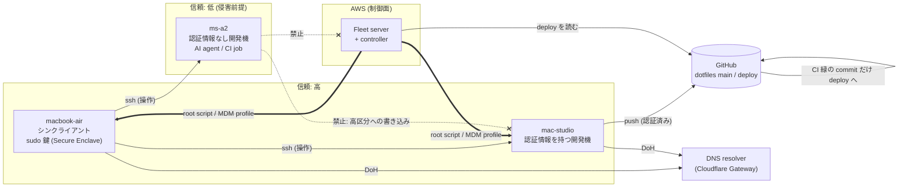
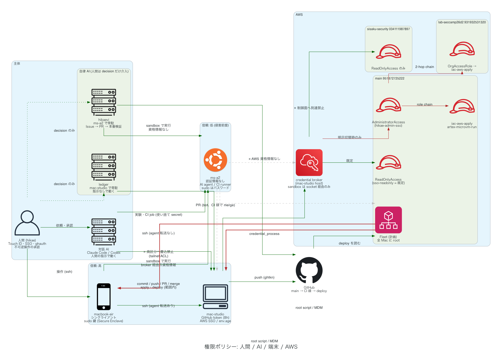

# 脅威モデル: 端末と管理基盤

## 1. 信頼区分

| 端末        | 役割                                                                | 持つ認証情報                                                                                              | 信頼                             |
| ----------- | ------------------------------------------------------------------- | --------------------------------------------------------------------------------------------------------- | -------------------------------- |
| macbook-air | シンクライアント。手元で操作する入口                                | Secure Enclave の sudo 鍵 (Secretive、署名ごとに Touch ID)。tailnet の利用者 identity                     | 高。ここが落ちると他も落ちる     |
| mac-studio  | 認証情報を持つ開発機。自律 AI `ledger` が常駐                       | GitHub user token (ghtkn、8h)、AWS SSO、`~/.config/secrets/env.age` の secret、Claude / OpenAI の資格情報 | 高                               |
| ms-a2       | 認証情報を持たない開発機。自律 AI `hikaevi`・CI job・実験を走らせる | 原則なし (例外は §4 F3)                                                                                   | 低。侵害されている前提で設計する |
| AWS (Fleet) | 端末管理と dotfiles 配布の制御面                                    | Fleet admin、enroll secret、MDM の APNs 証明書                                                            | 高。全 Mac に root で書ける      |

**不変条件:** 信頼の低い区分から高い区分へは、書き込みもコード実行もさせない。ms-a2 から mac-studio・macbook-air・AWS の制御面へ向かう経路は、読み取りも含めて最小にする。

## 2. 構成と信頼境界

太線は root 権限での書き込み。Fleet は全 Mac の root を握るため、高区分の中でも最も強く守る。

## 3. 資産と脅威

| 資産                       | 脅威 (STRIDE)            | 影響                                          |
| -------------------------- | ------------------------ | --------------------------------------------- |
| mac-studio の GitHub token | 漏洩 (I)、なりすまし (S) | 全 repo への push、release、secret の読み出し |
| dotfiles `deploy` branch   | 改ざん (T)               | Fleet 経由で全 Mac に root で配られる         |
| Fleet admin / API token    | 権限昇格 (E)             | 全 Mac での任意コード実行、MDM による消去     |
| sudo 鍵 (Secretive)        | 署名の不正利用 (E)       | 署名を受け付ける全 host の root               |
| DNS resolver の設定        | 改ざん (T)               | 遮断の解除、名前解決の乗っ取り                |

## 4. 検出した経路と対策

| #   | 経路                                                                                                                                                                                                | 現状                                                       | 対策                                                                                                | 状態                                                                     |
| --- | --------------------------------------------------------------------------------------------------------------------------------------------------------------------------------------------------- | ---------------------------------------------------------- | --------------------------------------------------------------------------------------------------- | ------------------------------------------------------------------------ |
| F0  | ms-a2 上の Fleet が全 Mac に root script を流せる                                                                                                                                                   | ms-a2 に Fleet server と controller があった               | ms-a2 から撤去し AWS に移す                                                                         | 撤去済み (データも削除)。AWS 構築は未着手                                |
| F1  | sudo 鍵の agent を ms-a2 へ転送している。ms-a2 の root は転送中の agent に署名を要求でき、同じ鍵を信頼する mac-studio の sudo に使える。Touch ID の確認画面では、どの host の sudo かを区別できない | macbook-air が `ms-a2 mac-studio` に `ForwardAgent`        | ms-a2 への転送をやめる。ms-a2 の sudo はパスワードにする                                            | 対応済み。flake check `ms-a2-no-sudo-agent` が回帰を止める               |
| F2  | gypxy hub が ms-a2 にある。mac-studio と macbook-air の git は gh-intel 宛ての通信を hub 経由にし、GitHub user token を hub に渡す。ms-a2 は token を読めるうえ、取得するコードを改ざんできる       | `programs.gypxy.client.enable = true` (既定)、hub は ms-a2 | hub を高区分 (AWS) に移すか、高区分の端末では client を無効にする                                   | 対応済み。各端末の loopback で hub を動かし、gh は github.com に直接繋ぐ |
| F3  | ms-a2 の claude self-hosted runner が `/etc/claude-runner/env` に token を持つ                                                                                                                      | 「認証情報なし」の例外                                     | token の権限を runner 登録だけに絞り、失効手順を持つ。可能なら gh-runner と同じく broker 経由にする | 未対応                                                                   |
| F4  | tailnet の ACL。ms-a2 は利用者と同じ identity で登録されており、既定 ACL では mac-studio・macbook-air の全 port と Tailscale SSH に届く                                                             | ACL がコード管理されていない                               | ms-a2 を `tag:untrusted-dev` にし、高区分への通信を拒否する ACL をコードで管理する                  | ACL 適用済み (テスト付き、`iac-tailscale`)。ms-a2 への tag 付与が未了    |

## 5. CI runner の扱い

ms-a2 の self-hosted runner (`hikae-<N>vcpu-ubuntu-2404`) の job が secret や OIDC を使うことは許容する。job ごとに使い捨ての環境で受け取り、終われば消えるため。禁止するのは、ホストに資格情報が最初から置かれている状態である。

## 6. Fleet を AWS に置く設計方針

- 公開面: tailnet 内からだけ到達できるようにする (subnet router か Tailscale on ECS)。インターネットに公開しない
- 実行: ECS Fargate。DB は Aurora MySQL Serverless v2 (0 ACU で自動停止)、Redis は ElastiCache
- 秘密: DB パスワード、`server_private_key`、admin 資格情報、enroll secret は Secrets Manager。端末と repo には置かない
- controller: 同じ VPC の Lambda か ECS scheduled task。`deploy` branch だけを読む。`deploy` は CI 緑の main だけが fast-forward する
- 変更経路: iac-aws の main push から OIDC で apply する。ms-a2 の runner には、この state と role を触らせない

## 7. 残るリスク

- macbook-air が侵害されると、sudo 鍵の署名要求を Touch ID で通してしまう可能性がある。Touch ID の確認画面に要求元が出ないため、利用者は区別できない
- GitHub の main を書き換えられる者 (mac-studio の token 保有者) は、CI を通れば全 Mac に配布できる。CI は改ざん検知ではなく品質の関門にすぎない
- Fleet の MDM を有効にすると、Fleet admin は端末を消去できる。admin は SSO と多要素認証で守る

## 8. 権限ポリシー図

`uv run docs/security/policy_diagram.py` で再生成する。
